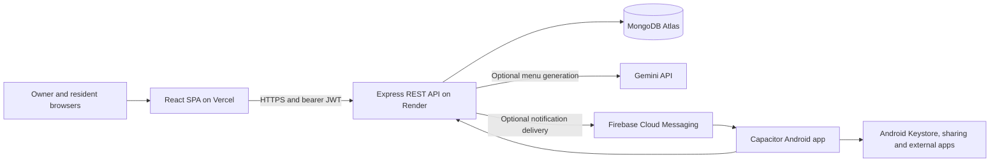
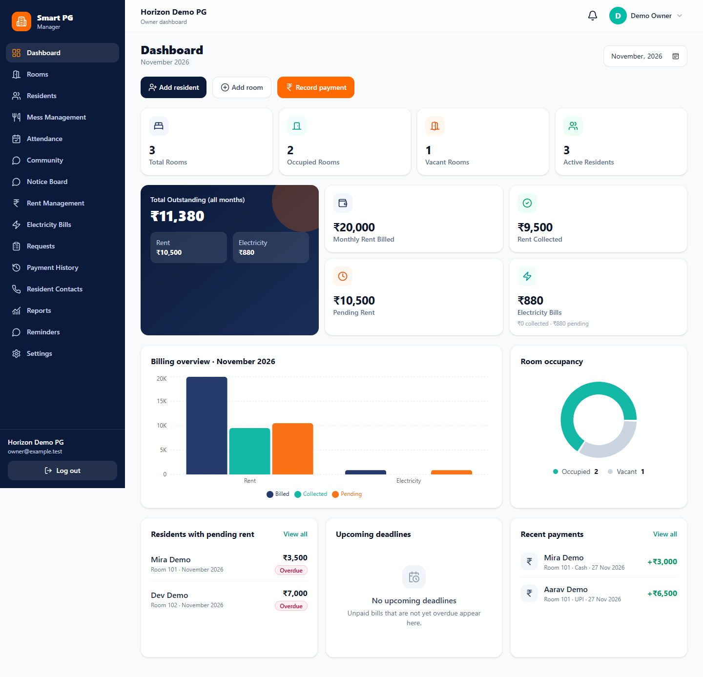
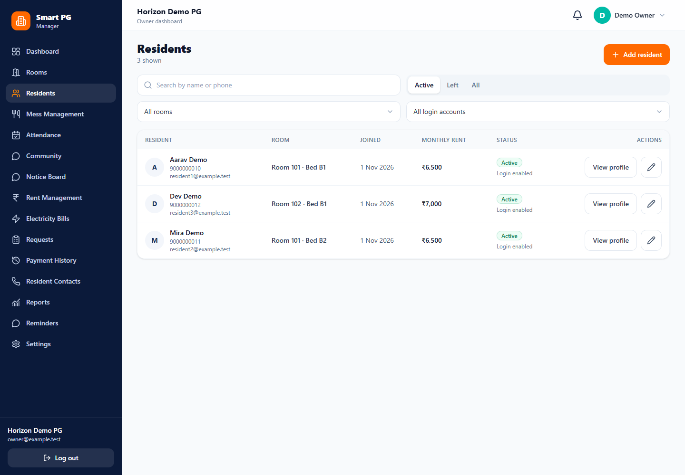
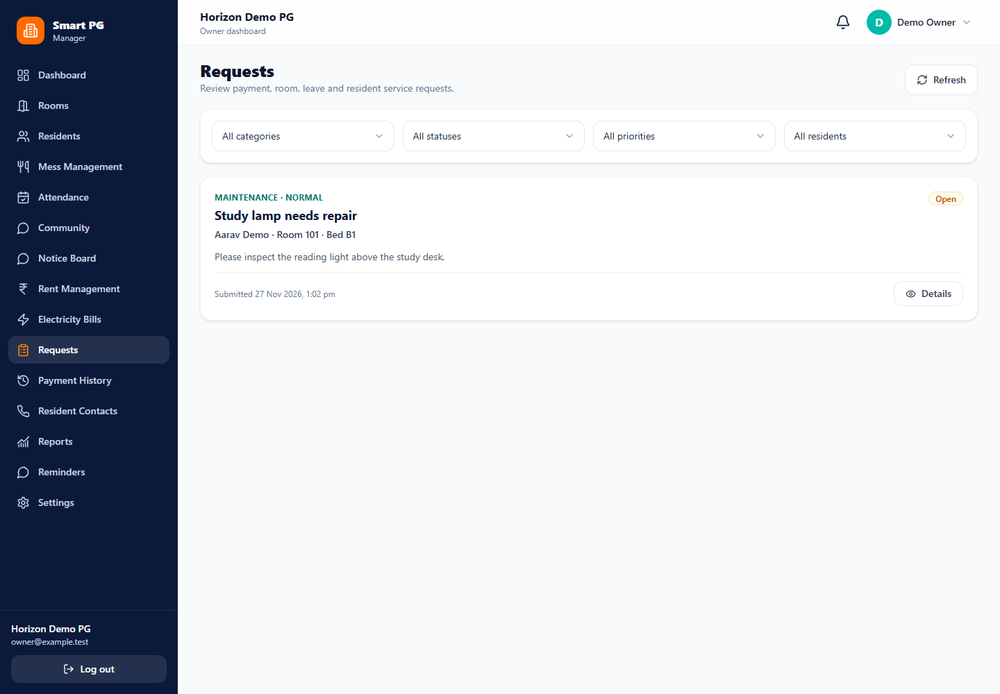
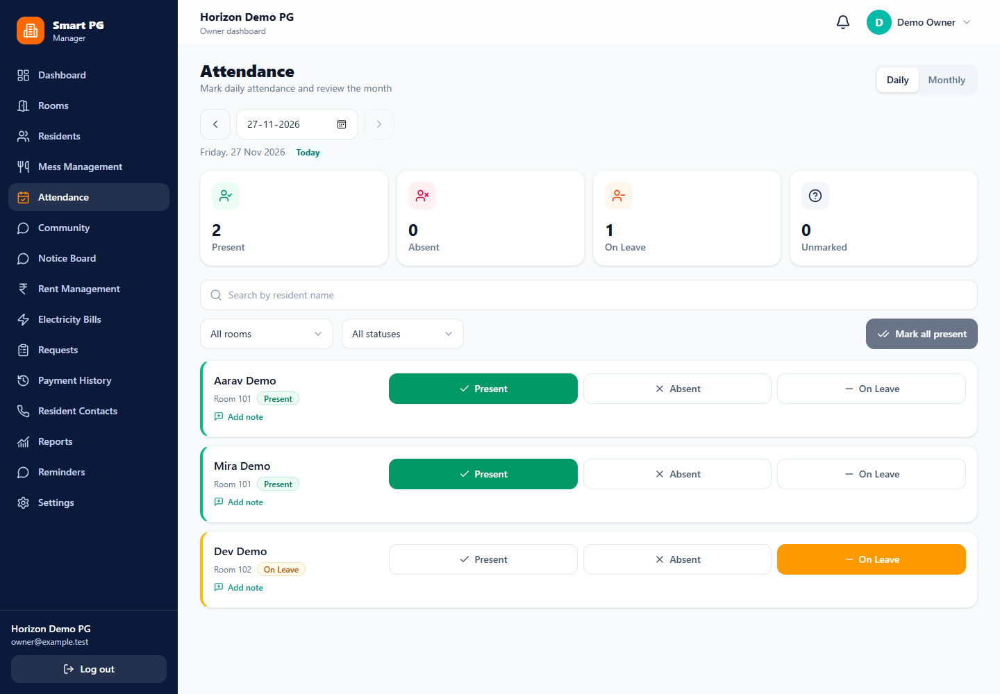
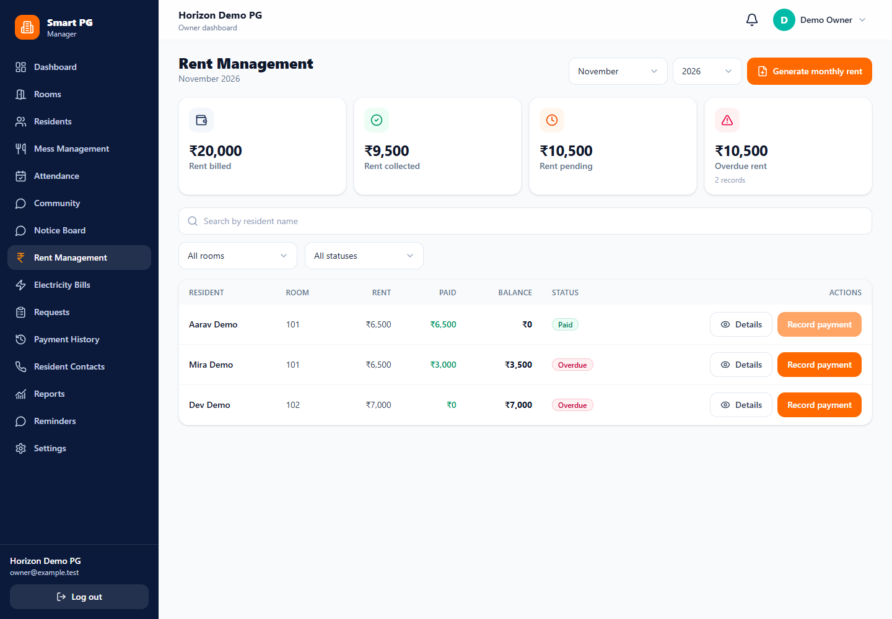
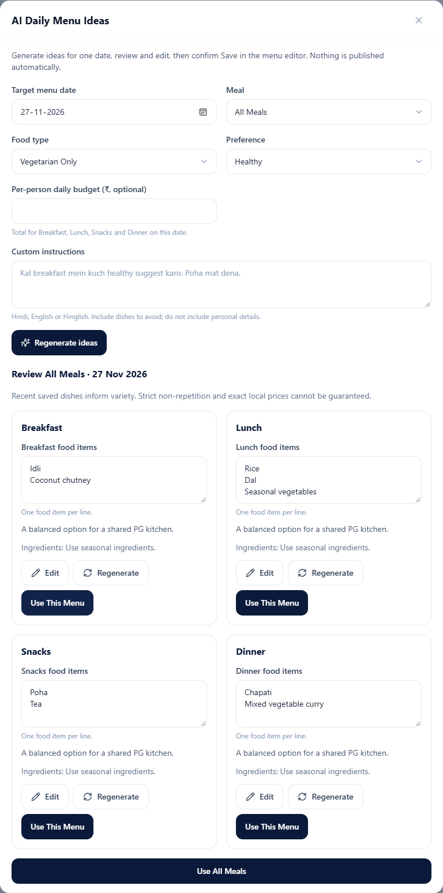
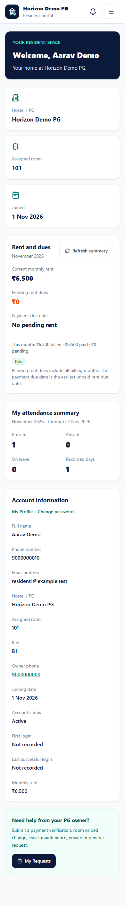

<div align="center">
  
  <h1>Smart PG Manager</h1>
  <p><strong>Property operations, resident services and daily meal planning in one place.</strong></p>
  <p>A full-stack web application with a Capacitor Android client for paying guest accommodation.</p>
  <p>
    <a href="https://smart-pg-manager.vercel.app">Live website</a> ·
    <a href="https://github.com/amparkhi21/Smart_PG_Manager/releases/tag/v1.0.0">Existing Android release</a> ·
    <a href="#screenshots">Screenshots</a> ·
    <a href="#local-development">Local setup</a>
  </p>
  <p>
    
    
    
    
    
  </p>
</div>

## Overview

PG owners often manage occupancy, rent, attendance and resident requests across spreadsheets, messages and paper records. Residents have to ask for the same room, bill and meal information repeatedly.

Smart PG Manager brings these workflows into separate owner and resident portals. Owners manage property operations and review requests; residents access their own records, submit requests and follow updates. An optional Gemini-powered planner helps owners prepare daily mess menus while keeping review and publication under their control.

**Explore:** [Owner sign-in](https://smart-pg-manager.vercel.app/owner/login) · [Resident sign-in](https://smart-pg-manager.vercel.app/resident/login)

## Owner portal

| Area | Capabilities |
| --- | --- |
| Dashboard | Room occupancy, collections, outstanding dues, recent payments and deadlines. |
| Rooms and residents | Capacity and bed assignments, resident profiles, contact search, account activation/reset and preserved departure history. |
| Unified Requests | Payment verification, room/bed changes, leave, maintenance and private issues with status and response history. |
| Attendance | Daily and bulk marking, room filters and monthly summaries. |
| Billing | Monthly rent, room electricity readings, partial payments, payment history and recorded-payment receipts. |
| Community | Notices, community messages and authorized photo access. |
| Communication | In-app notifications, optional Android push and editable WhatsApp reminder drafts; sending remains manual. |
| Reporting | Monthly summaries, PDF reports and eight CSV export formats. |
| Settings | Property details, billing defaults, UPI details and reminder preferences. |

## Resident portal

- Sign in using the hostel, room, bed and individual password supplied through the owner-managed account workflow.
- View personal dashboard, profile, assigned room and available rooms.
- Follow recorded attendance and rent/electricity information.
- Submit payment-verification, room-change, leave and service requests; read decisions and replies.
- Read published daily menus, notices, community updates and account notifications.
- Change passwords and optionally enable Android push notifications.

Residents see account-scoped data. Shared electricity is shown as room totals when no individual share has been assigned. A submitted payment claim is not treated as a confirmed payment until the owner verifies receipt.

## AI Daily Mess Menu Planner

The optional server-side Gemini integration creates ideas for **one date**: all four meals together, or individual meal suggestions.

- Vegetarian/non-vegetarian choices, healthy/budget/high-protein preferences and optional per-person budgets.
- Hindi, English or Hinglish instructions and recent saved-menu context for variety.
- Editable previews and regeneration of individual meal cards.
- Explicit owner confirmation before saving or overwriting a published menu.
- Validated provider responses, bounded timeouts and actionable error recovery.

AI suggestions are advisory; exact prices, nutrition and non-repetition are not guaranteed. Gemini credentials remain on the server. Missing AI configuration does not prevent manual menu management.

## Android application

The Android client packages the React application with Capacitor and adds native Back handling, safe-area/keyboard support, secure session storage, clipboard/external-link handoff and PDF/CSV sharing.

| Local application identity | Value |
| --- | --- |
| Package ID | `com.smartpgmanager.app` |
| Version / code | `2.1.0` / `4` |
| Minimum / target Android API | `24` / `36` |
| WebView origin | `https://localhost` |

The [existing published Android release is v1.0.0](https://github.com/amparkhi21/Smart_PG_Manager/releases/tag/v1.0.0). It is separate from the local **2.1.0 debug build**; this README does not claim a signed 2.1.0 release has been published. Physical-device acceptance and real push-delivery checks remain pending.

## Technology stack

| Layer | Technologies |
| --- | --- |
| Frontend | React 18, Vite 6, Tailwind CSS 4, React Router, Axios, Lucide |
| Visualization and exports | Recharts, jsPDF, browser downloads and native sharing |
| Backend | Node.js 24, Express 4, Mongoose, express-validator |
| Authentication | JWT, bcrypt password hashing, owner/resident authorization |
| Database | MongoDB; production hosting uses Atlas |
| AI and push | Google GenAI SDK; optional Firebase Admin and Capacitor Push Notifications |
| Android | Capacitor 8, Java 21, Gradle and Android SDK |
| Verification | Node test runner, Playwright, disposable MongoDB instances |
| Hosting | Vercel frontend, Render API |

## System architecture



The browser and Android client share the API. Authorization, tenant scoping and business validation run on the server. AI previews require a separate owner-confirmed save before becoming resident-visible menus.

## Project structure

Current checked-out layout; ignored dependencies, local credentials and generated outputs are omitted below.

```text
smart-pg-manager/
├── docs/
│   ├── architecture/          # Project boundaries
│   ├── operations/            # Verification and diagnostic runbooks
│   ├── android/               # Build, device testing and Firebase
│   ├── archive/               # Historical Android implementation records
│   └── screenshots/           # Actual UI captures with synthetic demo data
├── frontend/
│   ├── android/               # Native Android project
│   ├── e2e/                   # Browser regression specifications
│   ├── public/brand/          # Project logo
│   ├── scripts/               # Branding and production artifact checks
│   ├── src/
│   │   ├── api/, components/, context/, hooks/
│   │   ├── layouts/, native/, pages/, utils/
│   │   ├── App.jsx
│   │   └── main.jsx
│   ├── capacitor.config.json
│   ├── playwright*.config.js
│   ├── vercel.json
│   └── package.json
├── server/
│   ├── scripts/               # Database, startup and repository diagnostics
│   ├── src/
│   │   ├── config/, controllers/, middlewares/
│   │   ├── models/, routes/, seed/, utils/
│   │   ├── app.js             # Express application composition
│   │   ├── services/          # Business operations, Gemini and notification workers
│   │   ├── constants.js       # Shared enums and configuration defaults
│   │   └── index.js           # Startup, push worker and graceful shutdown
│   ├── test/                  # Isolated backend regressions
│   ├── .env.example
│   └── package.json
├── render.yaml
└── README.md
```

Both applications have their own `package-lock.json`. Actual `.env` files, Firebase client configuration, signing material, caches and builds remain local and ignored.

## Screenshots

Actual application captures from a disposable local MongoDB database. All people, contacts, accounts and financial records shown are synthetic demo data. The AI preview uses deterministic demo output, not a live provider response. Desktop captures and the mobile browser capture do not establish physical Android-device testing.

### Owner operations

| Dashboard | Resident management |
| --- | --- |
|  |  |

| Unified Requests | Attendance |
| --- | --- |
|  |  |

### Billing and meal planning

| Rent management | AI menu preview |
| --- | --- |
|  |  |

### Resident portal on a mobile viewport



## Local development

**Prerequisites:** Node.js 24, npm and an isolated development MongoDB database. Use a local replica set or a dedicated development Atlas database for transaction-backed workflows. Android builds additionally require JDK 21 and Android SDK 36. Playwright uses Microsoft Edge by default on Windows; `PLAYWRIGHT_CHANNEL` can select another installed channel.

```bash
git clone https://github.com/amparkhi21/Smart_PG_Manager.git
cd Smart_PG_Manager
npm ci --prefix server
npm ci --prefix frontend
```

Create `server/.env` and `frontend/.env` from the corresponding `.env.example` files **only if those local files do not already exist**. Fill placeholders privately. Do not overwrite existing credentials or use the production database for demo writes.

Run in separate terminals from the repository root:

```bash
npm run dev --prefix server
```

```bash
npm run dev --prefix frontend
```

Open `http://localhost:5173`. On Windows PowerShell, use `npm.cmd`/`npx.cmd` if script execution policy blocks `npm`/`npx`. The optional seed command replaces its demo account's records; use it only with a disposable development database.

## Environment configuration

These are documentation placeholders, not working credentials. The complete templates are [server/.env.example](server/.env.example) and [frontend/.env.example](frontend/.env.example).

| Backend variable | Safe example / purpose |
| --- | --- |
| `NODE_ENV` | `development` locally; `production` on Render |
| `PORT` | `5000` locally; supplied by Render in production |
| `MONGO_URI` | `mongodb+srv://<db-user>:<url-encoded-password>@<atlas-host>/<development-database>` |
| `JWT_SECRET` | `<unique-random-secret-at-least-32-characters>` |
| `JWT_EXPIRES_IN` | `7d` |
| `CLIENT_URL` | `http://localhost:5173`; exact comma-separated approved origins |
| `GEMINI_API_KEY` | `<server-only-gemini-key>`; optional |
| `GEMINI_MODEL` | `<supported-model-id>`; optional override of the configured default |
| `FCM_ENABLED` | `false` until push is configured |
| `FIREBASE_PROJECT_ID` | `<firebase-project-id>` |
| `FIREBASE_CLIENT_EMAIL` | `<firebase-service-account-email>` |
| `FIREBASE_PRIVATE_KEY` | `<server-only-private-key>`; never paste into client code |
| `FCM_TOKEN_ENCRYPTION_KEY` | `<independent-random-32-byte-key-as-64-hex-characters>` |

Frontend configuration:

```dotenv
# Local development only
VITE_API_BASE_URL=http://localhost:5000/api
```

Production uses `https://smart-pg-manager-backend.onrender.com/api`. Production builds enforce HTTPS and resolve missing or loopback API values to that backend. Vite variables are public build-time configuration: never put secrets in a `VITE_` variable. Android requires the backend to allow the exact `https://localhost` origin alongside the existing website origins.

## API modules

All paths below are relative to the configured backend host.

| Module | Route prefix |
| --- | --- |
| Authentication and sessions | `/api/auth` |
| Property and resident management | `/api/rooms`, `/api/residents`, `/api/settings` |
| Resident portal | `/api/resident` |
| Unified Requests | `/api/requests`, `/api/resident/requests` |
| Billing and payment verification | `/api/rent`, `/api/electricity`, `/api/payment-claims` |
| Attendance and mess menus | `/api/attendance`, `/api/mess-menus` |
| Community and notifications | `/api/community`, `/api/notifications` |
| Reporting and reminders | `/api/reports`, `/api/reminders` |
| Health and database readiness | `/api/health`, `/api/ready` |

Feature-specific complaint, leave, room-change and emergency-contact APIs remain available. Legacy request-screen URLs redirect to the unified Requests screens. Response envelopes and access rules are exercised by the regression suites.

## Authentication and security

- JWT bearer sessions, bcrypt password hashing and owner/resident role checks.
- Owner/PG-scoped queries and authorization checks on private records and mutations.
- Owner-managed resident login access, first-login password changes and session revocation.
- Transaction-aware occupancy/payment workflows, validation, rate limits, exact-origin CORS and security headers.
- Android sessions encrypted with a non-exportable Keystore key; browser sessions retain the existing browser-storage behavior.
- Explicit payment verification: resident-entered UTRs are claims, not proof of bank settlement.
- CSV formula escaping and private, cache-backed Android export sharing.
- Optional push with encrypted device tokens; private financial/request details stay out of lock-screen notification text.

Credential files and signing keys are ignored by Git. **`server/.env` exists in earlier Git history:** current ignore rules do not remove that exposure. Review and rotate affected credentials through the existing deployment before a public release; coordinate JWT rotation because it expires saved sessions. No history rewrite is part of ordinary setup.

## Automated verification

Most recent completed local regression runs, **27 November 2026**:

| Suite | Result |
| --- | --- |
| Backend regressions | **194 / 194 passed** |
| Frontend unit tests | **72 / 72 passed** |
| Isolated browser integrations | **19 / 19 passed** |
| Mocked browser scenarios | **48 / 48 passed**, no skips |
| Total | **333 passed** |

The frontend production build, compiled API/PDF/CSV checks, Capacitor sync and Android debug build also passed in the preceding verification work. These are local results, not a hosted CI status or proof that the live deployment matches this checkout. Physical-device acceptance, real FCM delivery and a new signed release remain separate checks.

Run unit tests and repository checks from the root:

```bash
npm test --prefix server -- --test-concurrency=1
npm test --prefix frontend
npm run check:repository --prefix server
git diff --check
```

Browser suites, from `frontend/` after installing both applications' dependencies:

```bash
npx playwright test phase android-runtime
npx playwright test --config playwright.portal.config.js
npx playwright test --config playwright.persistence.config.js
npx playwright test --config playwright.ai-mess.config.js --grep-invert "real Gemini"
```

Integration suites create disposable local MongoDB instances. The live Gemini test is opt-in and excluded above. The default mocked-browser configuration creates a test-mode `dist`; **rebuild production assets before Capacitor sync or distribution**:

```bash
npm run build
npm run test:build
```

See [release verification and diagnostics](docs/operations/release-verification.md) for evidence handling and database isolation.

## Deployment architecture

| Service | Existing configuration |
| --- | --- |
| Vercel web app | Root `frontend`; `npm ci`; `npm run build`; output `dist`; SPA routing/security headers in [frontend/vercel.json](frontend/vercel.json). |
| Render API | Root `server`; `npm ci --omit=dev`; `npm start`; Node 24; readiness probe `/api/ready`. |
| MongoDB Atlas | Existing database and records; credentials remain in server environment secrets. |
| Android | Bundled frontend assets connect to the same HTTPS API using the Capacitor origin. |

[render.yaml](render.yaml) is the existing optional Blueprint configuration with automatic deployment disabled. Do not import it as a new service when updating the existing service. Keep `CLIENT_URL` origins exact, preserve the database name and use the Render service's outbound ranges in the Atlas access list. `/api/health` checks API liveness; `/api/ready` checks database connectivity.

Root cleanup on 2026-11-27 retained this file: the live service's Blueprint association and configuration source could not be verified with the available access. Its optional label does not establish that production ignores it. Historical temporary evidence and backups are preserved in the [external archive](docs/archive/README.md); disposable project-local npm caches were removed. npm currently uses the Windows user-profile cache, and no project script or configuration requires `.npm-cache/`.

## Android debug build

With JDK 21 and Android SDK configured, run from the repository root in PowerShell:

```powershell
Push-Location frontend
npm.cmd run build
npx.cmd --no-install cap sync android
Push-Location android
$env:GRADLE_USER_HOME = Join-Path (Get-Location) '.gradle'
.\gradlew.bat :app:assembleDebug --console=plain
Pop-Location
Pop-Location
```

Check every command succeeds before continuing. Debug output:

`frontend/android/app/build/outputs/apk/debug/app-debug.apk`

Keep the existing Firebase client configuration and signing material local. This command produces a debug APK, not a store-ready signed release. Follow the [Android build and device-testing checklist](docs/android/build-and-device-testing.md) and [Firebase push guide](docs/android/firebase-push.md) before release.

## Documentation

- [Project structure and boundaries](docs/architecture/project-structure.md)
- [Release verification and startup/database diagnostics](docs/operations/release-verification.md)
- [Android build and physical-device testing](docs/android/build-and-device-testing.md)
- [Firebase and Android push configuration](docs/android/firebase-push.md)
- [Historical implementation records](docs/archive/README.md)

## Developer

Built by **Parkhi Kumari**, a full-stack developer and B.Tech Computer Science & Engineering student specializing in AI & Data Science.

[GitHub: @amparkhi21](https://github.com/amparkhi21) · [Project repository](https://github.com/amparkhi21/Smart_PG_Manager)
